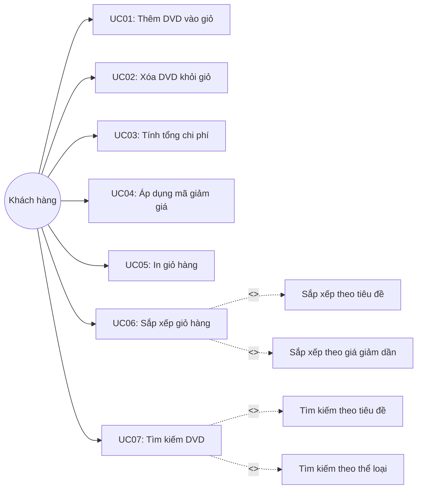

# Sơ đồ và Đặc tả Use Case — AIMS-mini

## 1. Tổng quan hệ thống
AIMS-mini là hệ thống quản lý giỏ hàng và danh mục đĩa DVD trực tuyến rút gọn, phục vụ thực hành môn Quản lý cấu hình phần mềm (IT3180).

## 2. Danh sách tác nhân (Actors)
- **Khách hàng (Customer)**: Người dùng thực hiện xem danh mục DVD, thêm/xóa DVD vào giỏ hàng, áp dụng giảm giá và xem chi tiết giỏ hàng.
- **Hệ thống (AIMS System)**: Xử lý lưu trữ, kiểm tra giới hạn giỏ hàng, tính toán chi phí, sắp xếp và tìm kiếm.

## 3. Danh sách Use Case
1. **UC01: Thêm DVD vào giỏ hàng (Add DVD to Cart)**
   - Mô tả: Cho phép khách hàng thêm một đĩa DVD vào giỏ hàng.
   - Ràng buộc: Giỏ hàng chỉ chứa tối đa 20 đĩa (`MAX_NUMBERS_ORDERED = 20`). Khi đủ 20 đĩa, từ chối thêm đĩa thứ 21 và hiển thị `"The cart is almost full"`.

2. **UC02: Xóa DVD khỏi giỏ hàng (Remove DVD from Cart)**
   - Mô tả: Cho phép xóa một đĩa DVD đang có trong giỏ hàng.

3. **UC03: Tính tổng chi phí giỏ hàng (Calculate Total Cost)**
   - Mô tả: Tính tổng giá thành các DVD hiện có trong giỏ hàng.

4. **UC04: Áp dụng giảm giá (Apply Discount)**
   - Mô tả: Tính tổng tiền sau khi giảm giá theo tỷ lệ phần trăm (0% – 100%).
   - Ngoại lệ: Ném ra ngoại lệ `ValueError` nếu phần trăm giảm giá không hợp lệ (< 0 hoặc > 100).

5. **UC05: In thông tin giỏ hàng (Print Cart)**
   - Mô tả: Hiển thị danh sách các đĩa đã đặt. Nếu giỏ hàng trống, in thông báo `"The cart is empty"`.

6. **UC06: Sắp xếp giỏ hàng (Sort Cart)**
   - Mô tả: Hỗ trợ 2 tiêu chí sắp xếp:
     - Sắp xếp theo tiêu đề (A-Z): `sort_by_title()`
     - Sắp xếp theo giá giảm dần (từ cao xuống thấp): `sort_by_cost()`

7. **UC07: Tìm kiếm DVD (Search DVDs)**
   - Mô tả: Hỗ trợ tìm kiếm theo tiêu đề (`search_by_title`, không phân biệt chữ hoa chữ thường) hoặc theo thể loại (`search_by_category`).

## 4. Sơ đồ Use Case (Mermaid)

